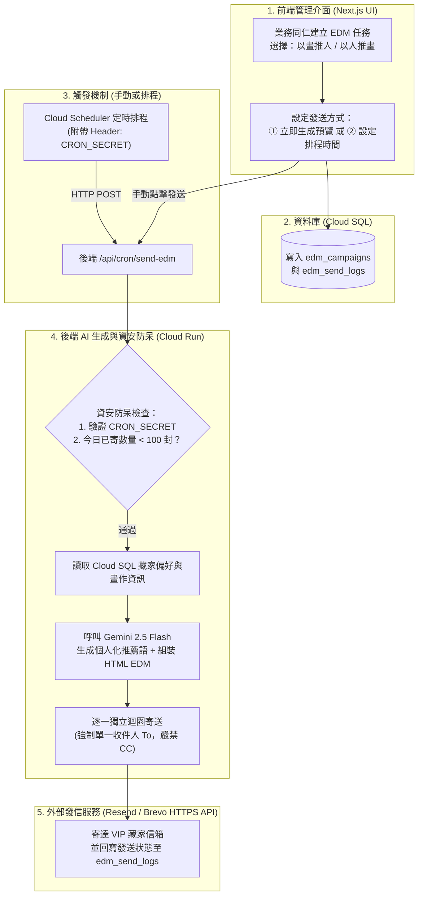

# 藏家推薦系統：新增「排程以人推畫／以畫推人發送客製化 EDM」開發者實作指南與收費標準說明

* **文件定位**：供「藏家推薦系統」開發者與專案負責人參考之技術實作規格書與雲端收費試算指南。
* **適用系統架構**：Google AI Studio（Build 模式）＋ Next.js（App Router / API Routes）＋ Google Cloud Run ＋ Google Cloud SQL。
* **功能定位**：屬系統擴充功能（於資安懶人包 Lazy Pack 中與「啟用 Vertex AI」並列為 **🟢 非必要選配項**，可於核心系統穩定後按本指南無縫加裝）。

---

## 第一章、 功能架構總覽與運作流程

為滿足業務部門**「設定排程（不定期或定期），自動執行『以人推畫』或『以畫推人』並發送自製客製化 EDM（圖文電子報）至藏家信箱」**之需求，同時確保雲端成本最低、信件不進垃圾桶且藏家個資不外洩，建議採用以下四大模組組合架構：

1. **雲端排程觸發器（Google Cloud Scheduler）**：負責在指定時間自動喚醒 Cloud Run 後端 API。
2. **AI 客製化 EDM 文案與圖片生成（Gemini 2.5 Flash）**：根據每位藏家的收藏偏好與畫作特色，一對一生成專屬推薦文案與 HTML 電子報。
3. **郵件發送服務（Transactional Email API：Resend 或 Brevo）**：透過 HTTPS API 穩定寄出高質感 HTML 圖文信件，取代易被封鎖的一般 Gmail SMTP。
4. **EDM 資安與個資防呆機制**：包含 `CRON_SECRET` 排程驗證、強制一對一單獨寄送（禁填 `CC`）、單日發信硬上限（`edm_daily_send_limit`）與業務預覽核准機制。

### 1.1 系統互動與資料流向圖



### 1.2 支援的兩種業務推薦模式

| 模式名稱 | 觸發情境 | AI 媒合與 EDM 生成邏輯 |
| :--- | :--- | :--- |
| **模式 A：以畫推人**<br>*(Art-to-Collector)* | 新進一幅（或一批）畫作、或特定展覽即將開幕，想找潛在買家。 | 1. 同仁勾選 1～3 幅目標畫作。<br>2. 系統從資料庫篩出「偏好媒材相符、歷史預算涵蓋該畫作價格區間」的目標藏家名單。<br>3. AI 針對**每一位藏家**過去的收藏風格，分別撰寫一段專屬開場白與「為何這幅新作適合您的收藏脈絡」之客製化推薦信。 |
| **模式 B：以人推畫**<br>*(Collector-to-Art)* | 針對特定 VIP 藏家清單（例如季末關懷、生日或久未聯繫藏家）進行個人化推薦。 | 1. 同仁勾選目標藏家名單（或設定篩選條件）。<br>2. AI 針對每位藏家的偏好標籤與預算，自動從目前「在庫可售畫作」中挑選最契合的 2～3 幅作品。<br>3. 為每位藏家產出「專屬您的本季私人策展推薦」HTML 電子報。 |

---

## 第二章、 資料庫擴充設計（Cloud SQL 新增資料表規格）

開發者不需改動現有的藏家與畫作核心結構，只需在 Cloud SQL（PostgreSQL / MySQL）中：
1. 於現有 `collectors`（藏家表）補充 2 個欄位（訂閱狀態與上次寄信時間）。
2. 新增 `edm_campaigns`（EDM 排程活動主表）與 `edm_send_logs`（EDM 個別寄送明細表）。

### 2.1 SQL 建表語法範例（以 PostgreSQL 為例）

```sql
-- 1. 於現有藏家表 (collectors) 新增退訂防呆與最後寄信時間欄位
ALTER TABLE collectors
  ADD COLUMN IF NOT EXISTS email_opt_in BOOLEAN DEFAULT TRUE,
  ADD COLUMN IF NOT EXISTS last_edm_sent_at TIMESTAMPTZ;

-- 2. 新增「EDM 排程與活動主表 (edm_campaigns)」
CREATE TABLE IF NOT EXISTS edm_campaigns (
  id SERIAL PRIMARY KEY,
  title VARCHAR(200) NOT NULL,                  -- 活動名稱（例：2026 秋季新進水墨畫作推薦）
  mode VARCHAR(30) NOT NULL,                    -- 'art_to_person' (以畫推人) 或 'person_to_art' (以人推畫)
  target_artwork_ids JSONB DEFAULT '[]',        -- 指定的畫作 ID 陣列
  target_collector_ids JSONB DEFAULT '[]',      -- 指定的藏家 ID 陣列
  custom_prompt_note TEXT,                      -- 業務補充給 AI 的當期語氣或展覽資訊
  banner_image_url TEXT,                        -- 當期共用主視覺橫幅 URL（選配）
  scheduled_at TIMESTAMPTZ,                     -- 預定自動發送時間（NULL 代表手動觸發）
  status VARCHAR(30) DEFAULT 'draft',           -- 'draft'(草稿) | 'preview_ready'(待業務核准) | 'scheduled'(已排程) | 'completed'(已完成) | 'failed'
  created_by VARCHAR(100),                      -- 建立此排程之同仁 Email
  created_at TIMESTAMPTZ DEFAULT NOW(),
  updated_at TIMESTAMPTZ DEFAULT NOW()
);

-- 3. 新增「EDM 個別寄送明細與稽核表 (edm_send_logs)」
CREATE TABLE IF NOT EXISTS edm_send_logs (
  id SERIAL PRIMARY KEY,
  campaign_id INTEGER REFERENCES edm_campaigns(id) ON DELETE CASCADE,
  collector_id INTEGER NOT NULL,                -- 對應藏家 ID
  collector_email VARCHAR(255) NOT NULL,        -- 實際寄送之目標信箱（僅單一信箱）
  recommended_artwork_ids JSONB NOT NULL,       -- 該封信推薦給該藏家的畫作 ID 清單
  email_subject VARCHAR(300) NOT NULL,          -- AI 生成之個人化信件主旨
  email_html TEXT NOT NULL,                     -- 最終寄出之完整 HTML 內容（留存備查）
  provider_message_id VARCHAR(150),             -- Resend / Brevo 回傳之 Message ID
  status VARCHAR(30) DEFAULT 'pending',         -- 'pending'(待寄) | 'sent'(已寄出) | 'failed'(失敗)
  error_message TEXT,
  sent_at TIMESTAMPTZ
);

-- 建立索引以加速「單日寄送上限 (edm_daily_send_limit)」統計查詢
CREATE INDEX IF NOT EXISTS idx_edm_send_logs_sent_at ON edm_send_logs(sent_at);
```

---

## 第三章、 四大核心模組之開發者實作步驟與程式碼範本

以下提供可直接整合進現有 Next.js（Google AI Studio 匯出架構）的完整實作方式：

---

### 3.1 模組一：AI 客製化 EDM 文案與圖片生成（`@google/genai`）

#### 開發要點：
1. **利用 Gemini 結構化輸出（`responseSchema`）**：讓模型一次回傳 JSON 格式的「信件主旨（`subject`）」、「個人化問候與推薦導言（`intro_paragraph`）」及「每幅畫作的專屬推薦亮點（`artwork_reasons`）」，再由後端程式套入固定的精美 HTML Email 骨架，避免 AI 自己寫 HTML 跑版。
2. **圖片處理策略（兼顧質感與零額外成本）**：
   - **畫作圖片**：直接在 HTML `` 引用資料庫中既有的**畫作高解析度圖檔網址**（藏家最在意作品真實細節，不應拿 AI 生成假圖代替原作）。
   - **活動主視覺 Banner（選配）**：若當期電子報需要一張頂部氛圍橫幅，可在建立活動時呼叫一次影像模型生成 **1 張當期共用 Banner** 存入 Cloud Storage，所有收件人共用該網址，避免每寄一封信就重複生圖。

#### 程式碼範本（`lib/edm-generator.ts`）：

```typescript
import { GoogleGenAI, Type } from '@google/genai';

// 從後端環境變數讀取金鑰（由 Secret Manager 掛載，前端不可見）
const ai = new GoogleGenAI({});

export interface CollectorProfile {
  id: number;
  name: string;
  email: string;
  preferredStyles: string[];
  preferredMediums: string[];
  budgetMaxNtd: number;
  aiSummaryNote: string;
}

export interface ArtworkItem {
  id: number;
  title: string;
  artist: string;
  medium: string;
  dimensions: string;
  priceNtd: number;
  imageUrl: string;
  aiCritique: string;
}

export async function generatePersonalizedEdm(
  collector: CollectorProfile,
  artworks: ArtworkItem[],
  campaignNote: string = ''
): Promise<{ subject: string; html: string }> {
  const prompt = `
你是一位專業且具高雅品味的藝術顧問。請根據以下「藏家偏好檔案」與「精選畫作清單」，為這位藏家撰寫一封專屬的私人藝術推薦信（EDM 文案）。
【嚴格規則】：
1. 只能推薦下方「精選畫作清單」內的作品，絕對不可捏造清單以外的畫作或價格。
2. 語氣溫潤、尊榮、具藝術專業度，巧妙呼應藏家喜愛的風格與媒材，但不要直接暴露我們後台紀錄的他的「預算數字上限」。
3. 業務補充說明：${campaignNote || '無'}

【藏家偏好檔案】：
- 稱呼：${collector.name}
- 偏好風格：${collector.preferredStyles.join('、')}
- 偏好媒材：${collector.preferredMediums.join('、')}
- 收藏脈絡備註：${collector.aiSummaryNote}

【精選畫作清單】：
${JSON.stringify(artworks, null, 2)}
`;

  const response = await ai.models.generateContent({
    model: 'gemini-2.5-flash',
    contents: prompt,
    config: {
      responseMimeType: 'application/json',
      responseSchema: {
        type: Type.OBJECT,
        properties: {
          subject: { type: Type.STRING, description: '高雅吸引人的個人化信件主旨' },
          greeting: { type: Type.STRING, description: '尊榮問候語，例如：敬愛的 王董事長 您好' },
          intro_paragraph: { type: Type.STRING, description: '結合藏家品味與本期作品的導言（約 80~120 字）' },
          artwork_highlights: {
            type: Type.ARRAY,
            items: {
              type: Type.OBJECT,
              properties: {
                artwork_id: { type: Type.INTEGER },
                personalized_reason: { type: Type.STRING, description: '為何這幅畫特別適合該藏家的推薦評語（約 60~100 字）' }
              },
              required: ['artwork_id', 'personalized_reason']
            }
          },
          closing: { type: Type.STRING, description: '結尾邀約賞畫與問候語' }
        },
        required: ['subject', 'greeting', 'intro_paragraph', 'artwork_highlights', 'closing']
      }
    }
  });

  const data = JSON.parse(response.text || '{}');

  // 組裝相容各家信箱 (Gmail / Outlook / Apple Mail) 的 Inline-CSS HTML 電子報
  const artworksHtml = artworks.map((art) => {
    const highlight = data.artwork_highlights?.find((h: any) => h.artwork_id === art.id);
    const reason = highlight ? highlight.personalized_reason : art.aiCritique;
    return `
      <div style="margin-bottom: 28px; border: 1px solid #e6e2dd; border-radius: 8px; overflow: hidden; background: #ffffff;">
        
        <div style="padding: 18px;">
          <h3 style="margin: 0 0 6px 0; color: #2c2523; font-size: 18px;">《${art.title}》— ${art.artist}</h3>
          <p style="margin: 0 0 10px 0; color: #786f68; font-size: 13px;">媒材：${art.medium} ｜ 尺寸：${art.dimensions}</p>
          <p style="margin: 0; color: #3d3531; font-size: 14px; line-height: 1.6;">${reason}</p>
        </div>
      </div>
    `;
  }).join('');

  const html = `
    <div style="max-width: 620px; margin: 0 auto; font-family: 'Noto Serif TC', 'PMingLiU', serif; background-color: #faf8f5; padding: 32px 24px; color: #2c2523;">
      <div style="border-bottom: 2px solid #b89f7d; padding-bottom: 16px; margin-bottom: 24px;">
        <span style="font-size: 12px; letter-spacing: 2px; color: #8c7355;">PRIVATE ART ADVISORY</span>
        <h2 style="margin: 6px 0 0 0; font-size: 22px; color: #2c2523;">專屬藝術典藏推薦</h2>
      </div>
      <p style="font-size: 16px; font-weight: bold; margin-bottom: 16px;">${data.greeting}</p>
      <p style="font-size: 15px; line-height: 1.8; color: #3d3531; margin-bottom: 28px;">${data.intro_paragraph}</p>
      ${artworksHtml}
      <p style="font-size: 15px; line-height: 1.8; color: #3d3531; margin-top: 24px;">${data.closing}</p>
      <hr style="border: none; border-top: 1px solid #e6e2dd; margin: 32px 0 16px 0;" />
      <p style="font-size: 12px; color: #999; text-align: center;">
        本信件為專屬藏家一對一推薦函。若您未來不希望收到電子報，請回覆告知，我們將立即為您調整。
      </p>
    </div>
  `;

  return { subject: data.subject, html };
}
```

---

### 3.2 模組二：郵件發送服務串接（Transactional Email API：Resend 或 Brevo）

#### 為什麼不使用一般免費 `@gmail.com` SMTP？
1. **Google Cloud Run 預設封鎖 Port 25**：傳統 SMTP 連線在無伺服器容器環境常遇連線失敗或逾時。
2. **Gmail 嚴格防垃圾信風控**：一般 `@gmail.com` 帳號若在幾分鐘內連續寄出數十封含大量圖片與 HTML 排版的信件，極易被 Gmail 判定為濫發垃圾信而**直接封鎖部門公務 Google 帳號**。
3. **專業發信 API（Resend / Brevo）優勢**：走標準 HTTPS (`Port 443`)、內建高信譽發信 IP、支援開信率與退信追蹤，且**免費額度高達每月 3,000～9,000 封（NT$0）**。

#### 程式碼範本（`lib/email-sender.ts`，以 Resend HTTPS API 為例，免裝額外套件）：

```typescript
export interface SendSingleEmailInput {
  toEmail: string;       // 強制單一收件人字串（非陣列、無 CC）
  subject: string;
  html: string;
}

export async function sendSingleEdmEmail(input: SendSingleEmailInput): Promise<{ id: string }> {
  const edmEnvValue = process.env.EDM_API_KEY;
  const fromAddress = process.env.EDM_FROM_ADDRESS || '藝術典藏顧問 <advisory@your-verified-domain.com>';

  if (!edmEnvValue) {
    throw new Error('缺少 EDM_API_KEY 環境變數，請確認已於 Secret Manager 設定並掛載。');
  }

  // 【資安防呆】：確保只傳入單一收件人，且絕對不包含 cc 或 bcc 欄位
  if (input.toEmail.includes(',') || input.toEmail.includes(';')) {
    throw new Error('安全攔截：禁止於單封 EDM 填入多位收件人，必須一對一獨立發送！');
  }

  const res = await fetch('https://api.resend.com/emails', {
    method: 'POST',
    headers: {
      'Authorization': `Bearer ${edmEnvValue}`,
      'Content-Type': 'application/json'
    },
    body: JSON.stringify({
      from: fromAddress,
      to: [input.toEmail.trim()], // 僅單一藏家信箱
      subject: input.subject,
      html: input.html
      // 嚴禁傳入 cc / bcc
    })
  });

  if (!res.ok) {
    const errText = await res.text();
    throw new Error(`發信 API 失敗 (${res.status}): ${errText}`);
  }

  return await res.json();
}
```

---

### 3.3 模組三：EDM 資安與個資防呆實作（後端排程路由 `/api/cron/send-edm`）

在後端實作 `/api/cron/send-edm/route.ts` 時，必須內建以下 **4 道資安與防呆防線**：
1. **防線 1：驗證 `CRON_SECRET`**：防止外部爬蟲或未授權人士猜到網址就觸發全體寄信。
2. **防線 2：強制「一對一單獨寄送（Single-Recipient Loop）」**：每位藏家獨立呼叫一次發信 API，`cc` 欄位永遠為空。
3. **防線 3：單日寄送硬上限（`EDM_DAILY_SEND_LIMIT`，預設 100 封）**：每次寄信前查詢 `edm_send_logs` 今日已寄出總數，超過上限立即停止，防止程式迴圈刷爆信箱與 Token。
4. **防線 4：二階段預覽確認（Preview before Send）**：排程可先將狀態設為 `preview_ready` 並寄預覽給業務，業務於後台點擊「確認寄出」將狀態改為 `scheduled` 後才正式對藏家發送。

#### 程式碼範本（`app/api/cron/send-edm/route.ts`）：

```typescript
import { NextRequest, NextResponse } from 'next/server';
import crypto from 'crypto';
import { generatePersonalizedEdm } from '@/lib/edm-generator';
import { sendSingleEdmEmail } from '@/lib/email-sender';

// 安全的常數時間字串比對，防止時序攻擊
function verifyCronHeader(authHeader: string | null): boolean {
  const expectedVal = process.env.CRON_SECRET;
  if (!expectedVal || !authHeader || !authHeader.startsWith('Bearer ')) {
    return false;
  }
  const provided = Buffer.from(authHeader.slice(7));
  const expected = Buffer.from(expectedVal);
  if (provided.length !== expected.length) return false;
  return crypto.timingSafeEqual(provided, expected);
}

export async function POST(req: NextRequest) {
  // 【防線 1】：驗證 CRON_SECRET
  if (!verifyCronHeader(req.headers.get('authorization'))) {
    return NextResponse.json({ error: 'Unauthorized cron trigger' }, { status: 401 });
  }

  const dailyLimit = Number(process.env.EDM_DAILY_SEND_LIMIT || 100);

  // 【防線 3】：檢查今日已寄出封數是否達硬上限 (偽代碼：請替換為專案實際 DB 查詢)
  // const sentTodayCount = await db.query("SELECT COUNT(*) FROM edm_send_logs WHERE sent_at >= CURRENT_DATE AND status = 'sent'");
  const sentTodayCount = 0;
  if (sentTodayCount >= dailyLimit) {
    return NextResponse.json({
      status: 'skipped',
      reason: `已達單日 EDM 發送硬上限 (${dailyLimit} 封)，自動中止發送以保護帳號信譽與預算。`
    });
  }

  // 查詢到期且已核准之排程任務 (status = 'scheduled' AND scheduled_at <= NOW())
  // 針對每位目標藏家進行「一對一迴圈生成與單獨寄信」（每次寄出後 sleep 500ms 避免觸發 API 速率限制）
  return NextResponse.json({ status: 'ok', message: 'Scheduled EDM batch processed safely.' });
}
```

---

### 3.4 模組四：雲端排程觸發器（Google Cloud Scheduler 設定步驟）

當開發者寫好 `/api/cron/send-edm` 並部署至 Cloud Run 後，只需在 Google Cloud Shell 執行以下指令，即可建立定時排程：

```bash
# 範例：設定每週二、週四早上 10:00（台北時間）自動觸發 Cloud Run 的 EDM 排程路由
gcloud scheduler jobs create http art-collector-edm-cron   --location="asia-east1"   --schedule="0 10 * * 2,4"   --time-zone="Asia/Taipei"   --uri="https://<您的-Cloud-Run-網址>/api/cron/send-edm"   --http-method="POST"   --headers="Authorization=Bearer <您的-CRON_SECRET>"
```

> ⚠️ **與 Cloud SQL「方案 3A（NT$500–600 平日上下班排程）」的重要連動提醒**：
> 若您的 Cloud SQL 資料庫採用 **方案 3A（平日 08:00 開機、22:00 自動休眠）**，請務必將上述 `--schedule` 時間設定在 **平日（週一至週五）08:30～21:30 之間**（例如 `0 10 * * 1-5`）。切勿設在半夜或週末，否則排程觸發時資料庫處於休眠狀態，會導致連線失敗！

---

## 第四章、 可直接貼給 Google AI Studio 的「一鍵擴充開發指令（Prompt）」

如果開發者目前仍在 **Google AI Studio** 內維護這套系統，可直接複製下方這段提示詞（Prompt）貼給 AI Studio，請它自動在現有專案加上 EDM 功能：

```text
請幫我在現有的「藏家推薦系統」中，新增「以人推畫／以畫推人 客製化 EDM 排程與發送管理功能」，並嚴格遵守以下資安與架構規範：

1. 【前端管理介面】：
   - 新增一個「EDM 推薦電子報管理」分頁。
   - 支援兩種模式切換：
     (a) 「以畫推人」：勾選 1~3 幅畫作，自動篩出預算與媒材符合的藏家名單。
     (b) 「以人推畫」：勾選目標藏家，自動為每位藏家匹配 1~3 幅在庫畫作。
   - 提供「生成 AI 客製化 EDM 預覽」按鈕：點擊後可預覽每位藏家專屬的信件主旨與 HTML 畫作推薦內容（畫作圖片直接引用資料庫現有畫作圖片 URL）。
   - 提供「先寄測試預覽信給我」與「設定排程／立即正式發送」按鈕。

2. 【後端 API 與資安防呆（極重要）】：
   - 新增後端 API `/api/edm/preview` 與排程端點 `/api/cron/send-edm`。
   - `/api/cron/send-edm` 必須驗證 HTTP Header `Authorization: Bearer ${process.env.CRON_SECRET}`。
   - 所有環境變數（`GEMINI_API_KEY`、`EDM_API_KEY`、`CRON_SECRET`）只能寫在後端 Server 端讀取，絕對不可放入前端或 `NEXT_PUBLIC_`。
   - 發信必須採「一對一單獨寄送迴圈」，每次呼叫發信 API 的 `to` 只能有 1 位藏家的 Email，且嚴禁填入 `cc` 或 `bcc` 欄位，防止藏家名單外洩。
   - 單日寄送總數不得超過 `process.env.EDM_DAILY_SEND_LIMIT`（預設 100 封）。
```

---

## 第五章、 各項服務收費方式、計費標準與整體月租套餐詳解

以下為導入「排程與客製化 EDM 功能」後，各雲端組件之官方計費標準與實際成本試算（匯率以 `1 USD ≈ 32.5 NTD` 估算）：

---

### 5.1 四大新增組件之單項收費標準明細表

| 組件項目 | 採用服務 / 方案選擇 | 免費額度 (Free Tier) | 超額或付費版計價標準 | 以部門每月寄 400 封 EDM 試算 |
| :--- | :--- | :--- | :--- | :---: |
| **1. 雲端排程器** | **Google Cloud Scheduler** | 每個帳單帳戶每月享有 **3 個免費排程工作（Jobs）** | 第 4 個排程起，每個排程每月 **US\$0.10（約 NT\$3.3 / 月）** | **NT\$0 / 月**<br>*(僅需 1～2 個排程，完全在免費額度內)* |
| **2. AI 客製化文案生成** | **Gemini 2.5 Flash**<br>*(AI Studio Paid Tier 或 Vertex AI)* | Paid Tier 按實際使用 Token 計費（享 100% 資料不訓練保障） | • 輸入：**US\$0.15 / 百萬 Tokens**<br>• 輸出：**US\$0.60 / 百萬 Tokens**<br>*(每封 EDM 約耗用 1,500 輸入 + 500 輸出 Tokens ≈ NT\$0.017 / 封)* | **約 NT\$7 / 月**<br>*(每月生成 400 封客製化文案總計不到台幣 10 元！)* |
| **3. AI 圖片生成**<br>*(選配)* | • **方式 A（推薦）**：直接引用資料庫現有畫作照片<br>• **方式 B（選配）**：Imagen 3 生成活動橫幅 | 畫作本身照片無 AI 生圖費 | • **Imagen 3 生圖**：每張 **US\$0.03～0.04（約 NT\$1.2 / 張）** | • **方式 A**：**NT\$0 / 月**<br>• **方式 B（每期共用 1 張橫幅）**：**約 NT\$5 / 月**<br>• **方式 B（每封信獨立生新圖）**：400 張約 **NT\$480 / 月** |
| **4. 郵件發送 API**<br>*(Transactional Email)* | • **選項 E1（推薦）**：**Resend**<br>• **選項 E2（推薦）**：**Brevo**<br>• **選項 E3**：**Amazon SES** | • **Resend 免費版**：**3,000 封 / 月**（單日限 100 封）<br>• **Brevo 免費版**：**9,000 封 / 月**（單日限 300 封）<br>• **AWS SES**：無免費層 | • **Resend Pro / Brevo 付費版**：約 **US\$20 / 月（約 NT\$650 / 月）**，解除單日上限並含進階分析<br>• **AWS SES**：每 1,000 封 **US\$0.10（約 NT\$3.3）** | • 選 **Resend / Brevo 免費版**：**NT\$0 / 月**<br>• 選 **AWS SES**：**約 NT\$2 / 月**<br>• 選 **Resend Pro 專業版**：**約 NT\$650 / 月** |

> 💡 **關鍵發現**：
> 只要藏家規模在 **300 人以內**，且畫作圖片直接引用資料庫現有畫作圖檔，**加上「排程自動發送客製化 EDM」這項功能後，每個月新增的雲端與發信費用幾乎是 NT$0～NT$10 元**（因為 Cloud Scheduler 免費 3 個排程、Resend/Brevo 免費每月 3,000～9,000 封、Gemini 2.5 Flash 寫 400 封信只要 NT$7 元）！

---

### 5.2 整體系統月租收費方案三級總表（含資料庫、AI 推薦與排程 EDM）

將原有的「Cloud SQL 資料庫月租 + Cloud Run + AI 互動推薦」與上述「排程發送客製化 EDM」合併後，提供三種總月租套餐供部門依發展階段選擇：

| 總費用套餐 | 適用階段與藏家規模 | 資料庫規格 (Cloud SQL) | AI 端點與生圖策略 | 排程器 + EDM 發信服務 | **預估每月總費用** | 建議 GCP 預算警示 (`budget_monthly_ntd`) |
| :--- | :--- | :--- | :--- | :--- | :---: | :---: |
| **套餐 A：極簡省錢版** | 初期測試期<br>*(藏家 < 100 人，不定期少量發信)* | **方案 2：`db-f1-micro`**<br>(0.6GB RAM，24h 開機)<br>約 NT\$300/月 | AI Studio Paid Tier<br>+ 引用現有畫作圖檔<br>(AI 費約 NT\$30～50/月) | Cloud Scheduler (免費)<br>+ **Resend / Brevo 免費版**<br>(NT\$0/月) | **約 NT\$330～380 / 月** | 設 **NT\$600 / 月** |
| **套餐 B：部門推薦甜區版**<br>*(🌟 最推薦方案)* | 正式內部營運<br>*(藏家 100～300 人，平日定期/不定期推播 EDM)* | **方案 3A：`db-g1-small` (1.7GB 順暢版) ＋ 平日上下班自動開關機排程**<br>約 NT\$480～560/月 | AI Studio Paid Tier<br>*(或選配 Vertex AI)*<br>+ 引用現有畫作圖檔<br>(AI 費約 NT\$50～80/月) | Cloud Scheduler (免費，排程設於平日白天)<br>+ **Resend / Brevo 免費版**<br>(NT\$0/月) | **約 NT\$530～640 / 月**<br>*(精準控制在 500–600 甜區)* | 設 **NT\$1,000 / 月**<br>*(目前 `params.json` 預設值)* |
| **套餐 C：全天候專業行銷版** | 跨部門擴編 / 高頻行銷<br>*(藏家 > 300 人，需半夜發信、無單日上限與開信率追蹤)* | **方案 4：`db-g1-small`**<br>(1.7GB RAM，24h 全天候開機)<br>約 NT\$830/月 | AI Studio Paid Tier<br>或 **Vertex AI**<br>(AI 費約 NT\$100～200/月) | Cloud Scheduler (免費)<br>+ **Resend Pro / Brevo 付費版**<br>(約 NT\$650/月，US\$20) | **約 NT\$1,580～1,680 / 月** | 設 **NT\$2,000 / 月** |
