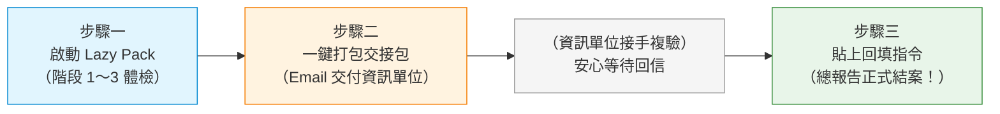

# 【通知與指引】使用 Lazy Pack 進行藏家推薦系統之資安掃描與合規驗收

> **信件主旨**：【資安合規指引】使用 Lazy Pack 進行「藏家推薦系統」雲端資安體檢與合規驗收說明  
> **發信對象**：藏家推薦系統負責人、專案開發與維運同仁、業務夥伴  
> **建議存放路徑**：`D:\Dev\company\art-collector-recommender\docs\letter-to-users-lazy-pack-guide.md`

---

各位專案同仁與系統負責人，您好：

因應年度雲端 AI 應用與資安合規治理要求，為確保「**藏家推薦系統（Art Collector Recommender）**」在保護藏家個資、防範雲端費用失控及抵抗 AI 惡意提示詞注入（Prompt Injection）上符合公司資安標準，我們已為專案量身打造了一套**「資安自動化檢查懶人包（Lazy Pack）」**。

為了讓大家不再視資安檢查為繁複沈重的負擔，本工具全面支援 **AI Agent 全程代操（Claude Code / ChatGPT / Antigravity / Cursor 等）**，您完全不需要具備複雜的資安背景或記憶任何底層指令，只要依照本指引即可輕鬆完成驗收！

---

## 🌟 本次 Lazy Pack 的三大核心特色（三「零」保證）

1. 🛡️ **零指令負擔（全程 AI 代操）**：
   所有檢查與設定皆已模組化，您只需要將指南交給 AI 小幫手（或在終端機開啟選單），AI 就會自動一步一步帶您完成。
2. 💰 **零意外開銷（費用透明與硬上限）**：
   內建「雲端服務開啟清單與每月費用精算器」，預設鎖定每月預算警示（NT$1,000）與每日呼叫硬上限（1,000 次），保證不會因外部異常呼叫而產生天價帳單。
3. 🤝 **零平台包袱（明確權責劃分）**：
   **您完全不需要去操作公司的自建弱掃平台！** 您的工作僅需在專案內完成體檢並產出「交接包」寄給資訊單位，後續的平台複驗全由資安同仁接手處理，審查通過後您只需貼上一行指令即可圓滿結案。

---

## 🚀 系統負責人只需完成的三個步驟

### 【前置準備：如何取得專案並交給 AI？】

如果您電腦裡還沒有本專案，請任選以下一種最順手的方式開始：

- 🌐 **方式 A（最推薦、零門檻）：直接把 GitHub 連結交給 AI**
  直接將專案 GitHub 網址複製並交給您的 AI Agent（Claude Code / ChatGPT / Antigravity / Cursor 等）：
  > 👉 **專案 GitHub 網址**：`https://github.com/argen9988/art-collector-recommender`
  > 
  > 💬 **對 AI 說**：*「請幫我 clone 這個 GitHub 專案，並依照裡面的領航指南（AGENT_SETUP_雲端資安設定與驗收指南.md）執行藏家系統 Lazy Pack 體檢」*  
  > （AI 就會自動 clone 專案、切換目錄並開始代操，您無需手動下載！）

- 📦 **方式 B（從 GitHub 下載 ZIP 包至本機）**
  1. 前往專案 GitHub 頁面：`https://github.com/argen9988/art-collector-recommender`
  2. 點擊右上角綠色的 **`Code` ➔ `Download ZIP`**，下載後解壓縮至電腦任意資料夾。
  3. 在該資料夾開啟終端機或 AI 工具，對 AI 說：*「我已解壓藏家推薦系統，請照指南幫我執行 Lazy Pack 體檢」*。

---

### 【步驟一：啟動 Lazy Pack 進行三階段體檢】
取得專案後，您可以直接對 AI 助手說：「**幫我執行藏家系統 Lazy Pack 體檢**」，或依序執行以下三個階段：
- **第一階段（立即止血與基礎防護）**：
  確保 Google AI Studio 綁定為 **Paid Tier 付費層**（保障客戶資料 100% 不被用於模型訓練）、設定雙 Owner 共管、鎖定每月預算與 API 呼叫上限，並設定同仁 Gmail 存取白名單。
- **第二階段（架構加固與規格選型）**：
  將 API 金鑰與資料庫連線字串隔離至 Secret Manager（前端零機密），並以互動式選單評估最佳資料庫方案（推薦兼顧效能與荷包的 `db-g1-small` 自動開關機方案，月租僅約 NT$500 左右）。
- **第三階段（原始碼掃描與 20 題 AI 驗收）**：
  進入前 AI 會提供「確認卡」供您選擇模式；腳本將翻遍程式碼確保無硬編碼金鑰，並使用 20 題模擬考題驗收 AI 推薦準確度（預算邊界防超支、防 CC 名單外洩、防駭客套話話術）。

---

### 【步驟二：一鍵打包交接包並寄給資訊單位】
當第三階段通過後，直接對 AI 說：「**幫我打包交接包**」（或執行 `node lazy-pack/code-and-ai-audit.mjs --handoff`）：
1. 系統會自動將檢查報告與經過安全脫敏的原始碼打包為 `ART-REC-xxxx.zip`。
2. 同步自動寫好一封信件草稿（`reports/handoff/ART-REC-xxxx-email-draft.txt`）。
3. 您只需將草稿內容複製、夾帶 ZIP 檔，Email 寄給資訊相關權責單位（資安同仁）。
👉 **寄出後，您的主體工作就已完成，可以暫時休息、安心等待資訊單位回信！**

---

### 【步驟三：收到審查回覆後一秒回填結案】
資訊權責單位收到交接包後，會在公司內網自建平台（OWASP ZAP / SonarQube）完成專業複驗，並透過 Email 回信告知審查通過及最終報告檔案路徑。

您收到回信後，只需回到本專案對 AI 說：
> *「弱掃平台測完了，幫我把結果 `<資訊單位提供的報告路徑>` 回填到 Lazy Pack 總報告」*

（或手動貼上指令：`node lazy-pack/code-and-ai-audit.mjs --platform-result "<路徑>"`）

專案的《全部執行累計總報告》（`reports/full-execution-report.md`）就會自動標註「**自架平台驗證：✅ 通過（雙軌合併審查）**」，為本次雲端資安檢測劃下完美句點！

---

## 📚 相關參考文件與指引

- 🤖 **給 AI 讀的全程代操指南**：[`AGENT_SETUP_雲端資安設定與驗收指南.md`](../AGENT_SETUP_雲端資安設定與驗收指南.md)（直接交給 AI Agent 即可無腦帶跑）
- 📖 **專案操作手冊與常見問題**：[`README.md`](../README.md)
- 🏢 **資訊單位內網自建平台 SOP**：[`docs/self-hosted-platform-verification-sop.md`](self-hosted-platform-verification-sop.md)（供了解資訊單位接手後的作業規範）

若在執行過程中有任何疑問、或需要協助確認雲端設定，歡迎隨時與專案資安輔導團隊聯繫。

謝謝大家對專案資安治理的共同投入與支持！

---
**藏家推薦系統 資安治理與自動化小組**  
2026 年 11 月
