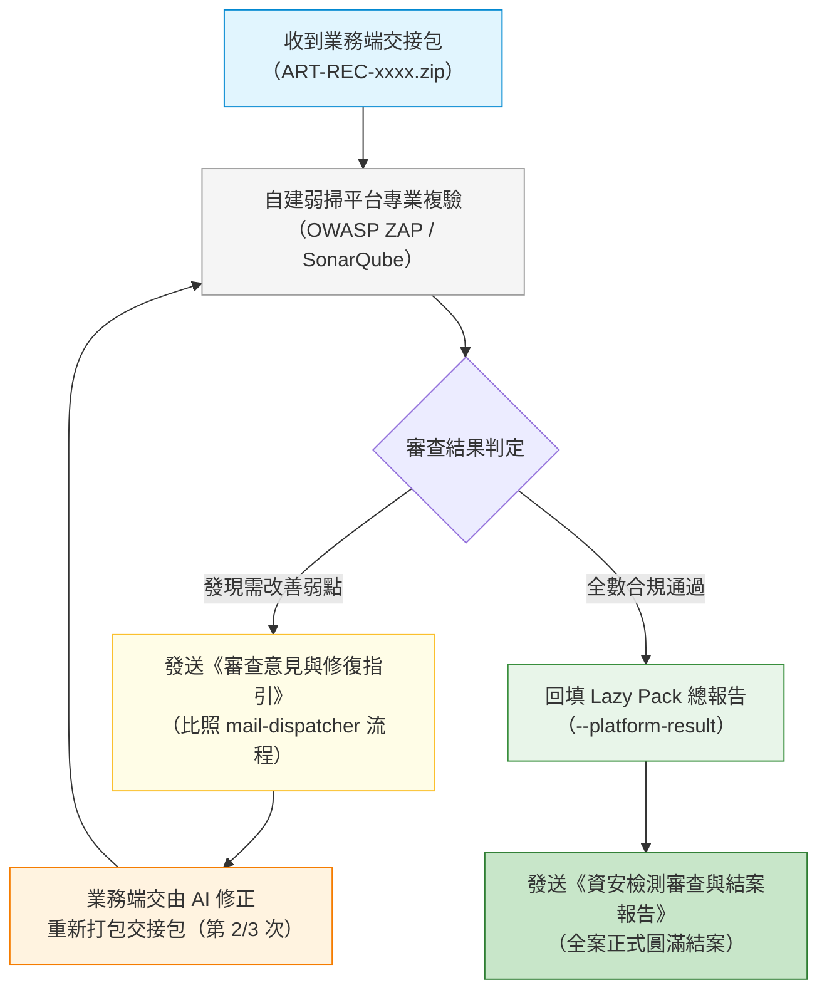

# 藏家推薦系統：自架平台複驗、往來審查與結案報告作業指引

> **文件定位**：資訊同仁於收到藏家推薦系統交接包後，在公司自建弱掃平台進行複驗、出具審查意見（多輪往來）及最終結案報告之標準作業流程（比照說明信之 mail-dispatcher 標準流程）。  
> **建議存放路徑**：`D:\Dev\company\art-collector-recommender\docs\security-review-and-closing-report-guide.md`  
> **適用角色**：資訊權責同仁、資安治理團隊  

---

## 🌟 核心理念與雙軌往來閉環

本作業流程與業務端說明信（`letter-to-users-lazy-pack-guide.md`）無縫銜接：
1. **明確權責**：系統負責人負責跑 Lazy Pack 產出交接包；自架弱掃平台（OWASP ZAP / SonarQube）複驗與結案報告則**由資訊同仁全程負責**。
2. **多輪往來閉環（Iterative Review）**：
   - 資安檢測並非一翻兩瞪眼；若初驗發現代碼弱點或架構需微調，資訊同仁出具《資安檢測審查意見與調整指引》Email，業務端交由 AI 調整後再次產包。
   - 雙方可能進行第 2 次、第 3 次來回修正與複驗，直到全數指標達標。
3. **正式結案雙動作**：
   - **動作一（總報告回填）**：資訊同仁執行 `node lazy-pack/code-and-ai-audit.mjs --platform-result "<報告路徑>"`，總報告標記為「通過 雙軌合併審查」。
   - **動作二（正式結案通知信）**：透過 `company-mail-dispatcher` 發送具備完整測試數據、合規背書與正式核准的《資安檢測審查與結案報告》Email 給系統負責人及相關主管同仁。



---

## 📋 往來信件範本（二擇一）

### 情境 A：發現需調整項目（第 N 次審查意見與調整指引）

> **主旨**：`【資安複驗意見】藏家推薦系統 第 [2/3] 次交接包審查與調整建議 [REF:ART-REC-REVIEW-R{N}]`  
> **收件人**：系統負責人  
> **副本**：相關專案同仁與主管、資訊同仁  

**信件範本重點**：
- 肯定專案已完成之體檢成果（第一、二階段及 AI 紅隊測試）。
- 列出自建平台複驗發現之具體項目（例如：弱掃檢測發現特定套件需升級、或前端某端點缺少 Security Headers）。
- 提供給 AI 的具體白話指示（讓系統負責人可直接複製交給 Claude Code / ChatGPT / Antigravity 代為修復）。
- 提醒修復完成後，再次執行 `node lazy-pack/code-and-ai-audit.mjs --handoff` 產出更新版交接包交付複驗。

---

### 情境 B：全數合格正式結案（《資安檢測審查與結案報告》）

> **主旨**：`【資安合規結案】藏家推薦系統 雲端 AI 資安體檢與自架平台複驗全數合格結案報告 [REF:ART-REC-CLOSED]`  
> **收件人**：系統負責人  
> **副本**：相關專案同仁與主管、資訊同仁  

**信件範本內容**：
1. **結案核准結論**：宣布「藏家推薦系統」已完整通過 Lazy Pack 三階段檢驗及資訊單位自建弱掃平台之雙軌安全複驗，確認具備上線與常態營運之資安合規資格。
2. **核心資安指標總結**：
   - 雲端 AI 隱私：Google AI Studio Paid Tier 綁定（客戶資料 100% 零訓練）。
   - 預算硬上限：每月預算警示 NT$1,000、每日呼叫上限 1,000 次，零超支風險。
   - 前端零機密：Secret Manager 金鑰隔離，前端 bundle 無敏感字串。
   - 資料庫防護：關閉公網 IP、強制 SSL、定時備份。
   - AI 紅隊防護：20 題 Prompt Injection、個資套話、預算邊界測試 100% 通過。
   - 平台弱掃複驗：OWASP ZAP 0 高中風險弱點、SonarQube 代碼品質合規。
3. **報告存查路徑**：
   - 專案累計總報告：`reports/full-execution-report.md`（已標記通過）
   - 資訊單位存查路徑：`D:\Dev\project-records\company\art-collector-recommender\`
4. **維運注意事項**：未來系統若有重大版本改版或新增雲端架構元件，再啟動定期複查。

---

## 🛠️ 自動化結案發信工具

比照說明信機制，資訊同仁可利用 `company-mail-dispatcher` 快速產出 Outbox JSON 檔案並進行試寄與發送：
1. 建立或更新 `outbox/art-collector-recommender_closing_report_<時間>.json`。
2. 執行試寄：
   ```powershell
   & "D:\Users\87094024\venvs\shared\Scripts\python.exe" -X utf8 "D:\Dev\company\company-mail-dispatcher\scripts\send_mail.py" --input "<outbox_path>" --preview-to-me argen@mail.pec.com.tw
   ```
3. 確認 Notes 排版後正式發送：
   ```powershell
   & "D:\Users\87094024\venvs\shared\Scripts\python.exe" -X utf8 "D:\Dev\company\company-mail-dispatcher\scripts\send_mail.py" --input "<outbox_path>" --send --confirm <batch_id>
   ```
