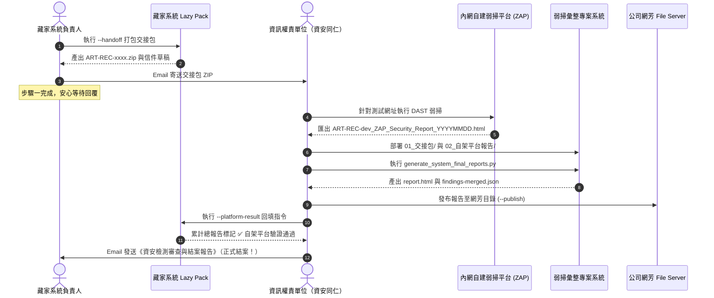

# 藏家推薦系統 — 自建弱掃平台驗證報告產出標準作業程序 (SOP)

> 本文件依據未來正式生產與資安審查環境規範編寫，旨在提供「藏家推薦系統負責人」與「資訊相關權責單位（資安審查同仁）」在執行自建平台弱點掃描、雙軌報告彙整與驗證回填時的標準作業指南。

---

## 📌 一、 基本資訊與核心原則

### 1. 系統定義
- **系統中文名稱**：藏家推薦系統
- **系統代號**：`ART-REC`
- **正式環境 URL**：`https://art-collector-recommender.a.run.app`（或公司自訂正式網域名稱）
- **測試環境 URL**：`https://art-collector-recommender-dev.a.run.app`
- **系統負責人**：藏家推薦系統開發與維運團隊

### 2. 核心資安業務原則
1. **權責分離原則**：
   - **藏家系統負責人**：負責跑本機與雲端 Lazy Pack（階段 1～3），產成交接包並 Email 交付；若收到審查意見由 AI 協助修復並重新打包。**負責人無需操作自建弱掃平台，亦無需手動執行弱掃回填。**
   - **資訊相關權責單位**：負責在公司內網自建平台（SecurityHub / OWASP ZAP / SonarQube）進行專業複驗、出具多輪審查意見，複驗通過後執行結案雙動作（回填總報告與發送結案通知）。
2. **測試環境代表原則**（公司弱掃規範）：
   - 對外 URL 包含 `-dev` 者為測試環境。
   - 弱掃執行與驗證一律以測試環境（`-dev`）優先；系統負責人在測試環境完成修復並自檢驗證通過後，其結果**亦代表並視同對應之正式環境已完成修復結案**。
3. **單一事實來源（SSOT 原則）**：
   - 公司網芳 File Server（`\\pecykfs02\VOL111\EC_TEAM\弱點掃描\`）為正式弱掃結果的唯一事實來源。

---

## 📂 二、 正式環境目錄與路徑規範

| 項目 | 正式環境位置 / 路徑 | 說明 |
| :--- | :--- | :--- |
| **藏家推薦系統專案** | `D:\Dev\company\art-collector-recommender\` | 系統負責人工作目錄（Lazy Pack 與交接包產生處） |
| **弱掃彙整專案目錄** | `D:\Dev\company\vulnerability-scan-summary\` | 資訊權責單位工作目錄（報告彙整腳本執行處） |
| **公司網芳根目錄** | `\\pecykfs02\VOL111\EC_TEAM\弱點掃描\2026\` | 公司正式年度弱掃資料庫（SSOT） |
| **網芳系統專屬目錄** | `\\pecykfs02\VOL111\EC_TEAM\弱點掃描\2026\ART-REC\` | 存放藏家系統歷次交接包與自架檢測報告 |
| **本機資料快取目錄** | `D:\Dev\company\vulnerability-scan-summary\data\2026\ART-REC\` | 資訊同仁本機彙整工作目錄 |
| **最終報告產出目錄** | `D:\Dev\company\vulnerability-scan-summary\reports\2026\final\ART-REC\` | 產出之 HTML 與 JSON 最終報告存放處 |

---

## 🛠️ 三、 正式環境六步驟標準作業程序



---

### 【步驟一：系統負責人產生並交付交接包】
在藏家推薦系統專案目錄執行：
```bash
cd D:\Dev\company\art-collector-recommender
node lazy-pack/code-and-ai-audit.mjs --handoff --system-name "藏家推薦系統" --system-code "ART-REC" --owner "系統負責人姓名" --env "dev"
```
1. **產出檔案**：
   - 交接包壓縮檔：`reports/handoff/ART-REC-<時間>.zip`
   - 信件草稿：`reports/handoff/ART-REC-<時間>-email-draft.txt`
2. **交付作業**：
   - 複製信件草稿內容，收件人填寫資訊權責單位信箱。
   - 夾帶 `ART-REC-<時間>.zip` 附件（若 ZIP 超過 10MB，依草稿提示改放雲端硬碟或共用資料夾）。
   - 寄出信件後，系統負責人工作暫告段落，等待資訊同仁回信。

---

### 【步驟二：資訊單位在自建平台執行弱掃】
由資訊同仁在公司內網環境操作（以標準 OWASP ZAP 為例）：
1. 開啟內網 OWASP ZAP 檢測工具。
2. **設定受測網址**：輸入測試環境網址 `https://art-collector-recommender-dev.a.run.app`。
3. **執行動態檢測**：點擊 Attack 執行 Automated Scan，爬梳端點並進行安全弱點探測。
4. **匯出報告**：掃描完畢後點擊 `Report` ➔ `Generate Report...`，格式選擇 **HTML**。
5. **強制命名規範**：檔名必須嚴格遵循公司日期後綴公式：
   - **公式**：`<系統代號>[-dev]_<工具>_<類型>_<YYYYMMDD>.html`
   - **正式命名範例**：`ART-REC-dev_ZAP_Security_Report_20261102.html`

---

### 【步驟三：將資料部署至弱掃彙整目錄】
資訊同仁在弱掃專案中建立該系統資料夾結構：
- 工作目錄：`D:\Dev\company\vulnerability-scan-summary\data\2026\ART-REC\`
- 建立並擺放兩個子資料夾：
  - 📂 **`01_交接包/`**：將負責人寄來的交接包 ZIP 解壓縮放進來。
    - 內容包含：`manifest.json`、`findings.json`、`full-execution-report.md`、`source.zip`、`README.md`。
  - 📂 **`02_自架平台報告/`**：放入步驟二匯出的 ZAP HTML 報告。
    - 內容包含：`ART-REC-dev_ZAP_Security_Report_20261102.html`。

---

### 【步驟四：執行弱掃彙整產生器（雙軌合併）】
資訊同仁開啟終端機，切換至弱掃彙整專案目錄並執行：
```bash
cd D:\Dev\company\vulnerability-scan-summary
python scripts/generate_system_final_reports.py --year 2026 --system ART-REC
```
> **腳本內部運作機制**：
> 1. 自動偵測到 `01_交接包/findings.json` 與 `02_自架平台報告/` 同時存在，自動啟動 **`merged_with_handoff`（雙軌合併）模式**。
> 2. 以 CWE 編號與受測 Target 為基準進行跨來源去重，整合 Lazy Pack 原始碼靜態問題與 ZAP 動態弱點。
> 3. 計算高、中、低風險弱點統計與【必要修復】項目清單。

---

### 【步驟五：檢視產出並發布至網芳正式目錄】
彙整完成後，成果將輸出至：
- **本機產出目錄**：`D:\Dev\company\vulnerability-scan-summary\reports\2026\final\ART-REC\`
  - 🌐 **`report.html`**：視覺化 HTML 弱掃結案報告（內含統計圖表、各弱點修復狀態與細項說明）。
  - 📄 **`findings-merged.json`**：機器可讀之合併弱點 JSON 數據檔案。

#### 正式發布至公司網芳（SSOT）
確認報告無誤後，資訊同仁執行帶 `--publish` 參數之指令發布至正式網芳：
```bash
python scripts/generate_system_final_reports.py --year 2026 --system ART-REC --publish
```
報告將同步歸檔至網芳：
`\\pecykfs02\VOL111\EC_TEAM\弱點掃描\2026\ART-REC\03_最終弱掃結果\`

#### 執行結案雙動作（回填總報告與正式結案通知）
複驗全數合規通過後，資訊同仁依序執行：
1. **動作一（總報告回填）**：在藏家推薦系統目錄執行回填指令（見步驟六）。
2. **動作二（發送結案通知）**：透過 `company-mail-dispatcher` 正式出具《資安檢測審查與結案報告》Email 給系統負責人及相關主管同仁（範本詳見 [`docs/security-review-and-closing-report-guide.md`](security-review-and-closing-report-guide.md)）。

---

### 【步驟六：資訊同仁回填閉環與發送結案通知（正式驗收結案）】
資訊同仁於藏家專案目錄執行回填指令：
```bash
cd D:\Dev\company\art-collector-recommender
node lazy-pack/code-and-ai-audit.mjs --platform-result "\\pecykfs02\VOL111\EC_TEAM\弱點掃描\2026\ART-REC\03_最終弱掃結果\findings-merged.json"
```
（若使用本機快取路徑，亦可帶入 `D:\Dev\company\vulnerability-scan-summary\reports\2026\final\ART-REC\findings-merged.json`）

#### 驗收成果
藏家推薦系統的累計總報告 [full-execution-report.md](file:///D:/Dev/company/art-collector-recommender/reports/full-execution-report.md) 之最後一行將正式更新為：
```markdown
- **自架平台驗證**：✅ 通過（雙軌合併審查，見最終弱掃結果 \\pecykfs02\VOL111\EC_TEAM\弱點掃描\2026\ART-REC\03_最終弱掃結果\findings-merged.json）
```
回填完成後，資訊同仁發送正式結案報告 Email，至此，藏家推薦系統從雲端基礎設施、Secret 管理、原始碼與 AI 體檢，到公司自建弱掃平台複驗，全案達成 100% 閉環與上線合規！

---

## ⚠️ 四、 異常狀況與防呆規範

1. **交接包被金鑰攔截擋下（結束碼 1）**：
   - 若程式碼中含有硬編碼之真實或測試 API Key、資料庫連線字串，`--handoff` 會拒絕打包並列出檔案。
   - **處置**：必須先將敏感資訊抽離至 Secret Manager 或 `.env.local`，不得私自強制打包。
2. **交接包 ZIP 大小超過上限**：
   - 依公司規範上限為 10MB。若超過 10MB，腳本會自動提示改放網芳或 Google Drive，信件草稿將自動切換為提供連結。
3. **多版次報告留存原則**：
   - `02_自架平台報告/` 允許且建議保留歷次掃描報告（如初測 `_20261015.html`、修復後複掃 `_20261102.html`）。
   - 系統彙整腳本會自動依照檔名日期由新到舊排序，一律以最新日期之報告作為最新判定基準，切勿覆蓋或刪除舊報告足跡。
